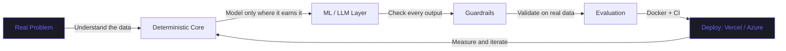
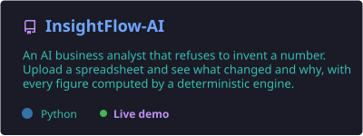
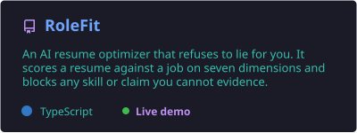
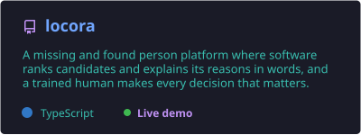
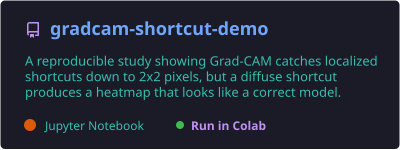
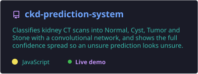
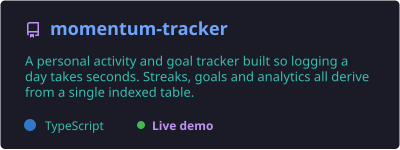

<p align="center">
  
</p>

<p align="center">
  <strong>Profile sync:</strong> <!--AUTO_UPDATE--> 2026-10-20
</p>

<p align="center">
  <em>Building machine learning systems and backends where every number is computed, tested and true</em>
</p>

<p align="center">
  <!--VIEWS_START-->
  
  <!--VIEWS_END-->
  &nbsp;
  <a href="https://www.linkedin.com/in/zain-ul-abideen3">
    
  </a>
  &nbsp;
  <a href="https://github.com/zain-ul-abideen-5036">
    
  </a>
</p>

---

### Who Am I


I'm an ML and backend engineer and a Computer Science graduate of the University of Central Punjab. I build machine learning systems and the backends that carry them into production, from data pipelines and trained models to APIs, databases and the product a person actually uses.

Most of my work starts from one observation: **a wrong number looks exactly like a right one on the page.** So I let code compute what can be computed, verify what I build before I trust it, and use a language model only where it earns its place. That is how I ended up building an analytics assistant that never invents a figure, and a resume tool that refuses to invent a skill you don't have.

---

### Current Orbit

Right now, I'm leading the AI and machine learning track at Digitech Offerings, where I designed and delivered an eight-week AI/ML programme for forty students, while working as a freelance software engineer building web platforms, backends and AI features for clients. The rest of my time goes into products that put correctness first: InsightFlow AI analyses business data with a deterministic engine, RoleFit rewrites resumes without fabricating a single claim, and JARVIS runs a full voice assistant entirely on one laptop. In between, I publish reproducible studies on how machine learning evaluation quietly misleads, and I'm open to full-time roles, freelance work and research collaborations.

---

## Roles & Recognition

<table align="center">
  <tr>
    <td align="center" valign="top" width="300">
      <br/>
      <br/><br/>
      <strong>Senior MLSA</strong><br/>
      <sub><b>Microsoft Learn Student Ambassador</b></sub><br/>
      <sub>Organizing AI events and bridging students<br/>with Microsoft's AI ecosystem globally</sub><br/><br/>
    </td>
    <td align="center" valign="top" width="300">
      <br/>
      <br/><br/>
      <strong>Gold Scout</strong><br/>
      <sub><b>Microsoft for Startups Program</b></sub><br/>
      <sub>Identifying and connecting high-potential<br/>startups with Microsoft resources</sub><br/><br/>
    </td>
    <td align="center" valign="top" width="300">
      <br/>
      <br/><br/>
      <strong>Ambassadors Projects Team Lead</strong><br/>
      <sub><b>Awarded March 2025</b></sub><br/>
      <sub>Led a team of students building and deploying<br/>AI projects on Microsoft technologies</sub><br/><br/>
    </td>
  </tr>
  <tr>
    <td align="center" valign="top" width="300">
      <br/>
      <br/><br/>
      <strong>BSc Computer Science</strong><br/>
      <sub><b>Nov 2021 to Jul 2025</b></sub><br/>
      <sub>Focus on AI, ML and deep learning. Final-year<br/>project: CKD Prediction System</sub><br/><br/>
    </td>
    <td align="center" valign="top" width="300">
      <br/>
      <br/><br/>
      <strong>Freelance Software Engineer</strong><br/>
      <sub><b>Sep 2025 to Present</b></sub><br/>
      <sub>Web platforms, backends and AI features<br/>delivered end to end for clients</sub><br/><br/>
    </td>
    <td align="center" valign="top" width="300">
      <br/>
      <br/><br/>
      <strong>AI &amp; Machine Learning Lead</strong><br/>
      <sub><b>Apr 2026 to Present</b></sub><br/>
      <sub>Designed and delivered an 8-week AI/ML<br/>programme for 40 students</sub><br/><br/>
    </td>
  </tr>
</table>

---


## Technical Arsenal

<table>
<tr>
<td valign="top" width="33%">

**Core Competencies**


**Languages**


</td>
<td valign="top" width="33%">

**AI / ML Stack**


**Data & Visualization**


**Web & Frontend**


</td>
<td valign="top" width="33%">

**Cloud & Infrastructure**


**Databases & ORMs**


**Dev Tools**


</td>
</tr>
</table>

---

## The AI/ML Roadmap I Live By



---

## Engineering Manifesto

<table align="center">
  <tr>
    <td align="center" width="200">
      <br/>
      <strong>Compute, Don't Guess</strong><br/>
      <sub>Code computes the numbers. A model only phrases them</sub>
    </td>
    <td align="center" width="200">
      <br/>
      <strong>Evaluate Honestly</strong><br/>
      <sub>A lucky split is not a result. Measure what matters</sub>
    </td>
    <td align="center" width="200">
      <br/>
      <strong>Private by Default</strong><br/>
      <sub>Sensitive data is never fetched, not fetched and hidden</sub>
    </td>
    <td align="center" width="200">
      <br/>
      <strong>Ship It Honestly</strong><br/>
      <sub>If it can't deploy, it doesn't exist. If it can't be checked, it isn't claimed</sub>
    </td>
  </tr>
</table>

---

## Featured Work Domains

<table align="center">
  <tr>
    <td align="center" width="300">
      <h3>Trustworthy AI Products</h3>
      <br/>
      <br/>
      <sub>AI that computes its facts and refuses to invent them</sub><br/>
      <sub><a href="https://insight-flow-ai-iota.vercel.app">InsightFlow AI</a> · <a href="https://rolefit-topaz.vercel.app">RoleFit</a> · JARVIS</sub>
    </td>
    <td align="center" width="300">
      <h3>Machine Learning & Vision</h3>
      <br/>
      <br/>
      <sub>Models judged by honest evaluation, not a lucky split</sub><br/>
      <sub><a href="https://ckd-prediction-system-six.vercel.app">CKD Prediction</a> · <a href="https://github.com/zain-ul-abideen-5036/har-leakage-demo">Leakage Demo</a> · <a href="https://github.com/zain-ul-abideen-5036/gradcam-shortcut-demo">Grad-CAM Study</a></sub>
    </td>
    <td align="center" width="300">
      <h3>Backend & Full-stack</h3>
      <br/>
      <br/>
      <sub>Secure, tested systems from schema to shipped product</sub><br/>
      <sub><a href="https://locora-chi.vercel.app">Locora</a> · <a href="https://momentum-tracker-self.vercel.app">Momentum</a> · <a href="https://zainulabideen-dev.vercel.app">Portfolio</a></sub>
    </td>
  </tr>
</table>

---

## Project Spotlight

<table align="center">
  <tr>
    <td align="center" width="50%">
      <a href="https://insight-flow-ai-iota.vercel.app"></a><br/>
      <a href="https://insight-flow-ai-iota.vercel.app"></a>
      <a href="https://github.com/zain-ul-abideen-5036/InsightFlow-AI"></a>
    </td>
    <td align="center" width="50%">
      <a href="https://rolefit-topaz.vercel.app"></a><br/>
      <a href="https://rolefit-topaz.vercel.app"></a>
      <a href="https://github.com/zain-ul-abideen-5036/RoleFit"></a>
    </td>
  </tr>
  <tr>
    <td align="center" width="50%">
      <a href="https://locora-chi.vercel.app"></a><br/>
      <a href="https://locora-chi.vercel.app"></a>
      <a href="https://github.com/zain-ul-abideen-5036/locora"></a>
    </td>
    <td align="center" width="50%">
      <a href="https://colab.research.google.com/github/zain-ul-abideen-5036/gradcam-shortcut-demo/blob/main/notebook/gradcam_shortcut_demo.ipynb"></a><br/>
      <a href="https://colab.research.google.com/github/zain-ul-abideen-5036/gradcam-shortcut-demo/blob/main/notebook/gradcam_shortcut_demo.ipynb"></a>
      <a href="https://github.com/zain-ul-abideen-5036/gradcam-shortcut-demo"></a>
    </td>
  </tr>
  <tr>
    <td align="center" width="50%">
      <a href="https://ckd-prediction-system-six.vercel.app"></a><br/>
      <a href="https://ckd-prediction-system-six.vercel.app"></a>
      <a href="https://zainulabideen-dev.vercel.app/work/ckd-prediction-system"></a>
    </td>
    <td align="center" width="50%">
      <a href="https://momentum-tracker-self.vercel.app"></a><br/>
      <a href="https://momentum-tracker-self.vercel.app"></a>
      <a href="https://zainulabideen-dev.vercel.app/work/momentum"></a>
    </td>
  </tr>
</table>

<p align="center">
  <a href="https://zainulabideen-dev.vercel.app"></a>
</p>

---

## GitHub Stats

<!-- Cards inside the START/END markers are checked daily by .github/scripts/daily_update.py. A card whose service is down is hidden and restored when it recovers. -->
<!--STATS_START-->
<p align="center">
  
  
</p>

<p align="center">
  
</p>

<p align="center">
  
</p>
<!--STATS_END-->

---

## Frequency Signature

> *Every engineer has a unique signal. Here's mine.*

```yaml
# ── SIGNAL PROFILE ──────────────────────────────────────────────
  handle     : "Zain Ul Abideen"
  origin     : "Pakistan 🇵🇰"
  signal     : "ML & Backend Engineering"

  transmitting:
    - "AI products where code computes the facts and models phrase them"
    - "Backends and APIs built for production, not just notebooks"
    - "Local-first AI that keeps personal data on the device"
    - "Honest evaluation, because a lucky split is not a result"

  frequency  : "Always learning. Always shipping."
  bandwidth  : "Deep focus + open collaboration"
  wavelength : "Where research meets real-world impact"
# ────────────────────────────────────────────────────────────────
```

---

## Code Cycle

<p align="center">
<a href="https://www.youtube.com/shorts/GAlKHqcnKTw">

</a>
<a href="https://www.youtube.com/shorts/FDoaXLRRwKw">

</a>
<a href="https://www.youtube.com/shorts/GAlKHqcnKTw">

</a>
</p>

---

## Thoughts That Shape My Work

<div align="center">
<!--QUOTE_START-->
  
<!--QUOTE_END-->
</div>

---


## Connect

<p align="center">
  <em>"The best engineers are those who collaborate, communicate, and compound their knowledge."</em>
</p>

<p align="center">
  <a href="mailto:zain.ul.abideen0877@gmail.com">
    
  </a>
  &nbsp;
  <a href="https://linkedin.com/in/zain-ul-abideen3">
    
  </a>
  &nbsp;
  <a href="https://zainulabideen-dev.vercel.app">
    
  </a>
  &nbsp;
  <a href="https://leetcode.com/u/QFk5w8f22b/">
    
  </a>
  &nbsp;
  <a href="https://medium.com/@zainulabideen5">
    
  </a>
  <br/>
  <a href="https://www.facebook.com/profile.php?id=61557016676124&mibextid=ZbWKwL">
    
  </a>
  &nbsp;
  <a href="https://www.instagram.com/zain.ul_abideen_?igsh=dHdkemsya2k5cThn">
    
  </a>
</p>

---

<p align="center">
  
</p>


<!---
zain-ul-abideen-5036/zain-ul-abideen-5036 is a ✨ special ✨ repository because its `README.md` (this file) appears on your GitHub profile.
You can click the Preview link to take a look at your changes.
--->
